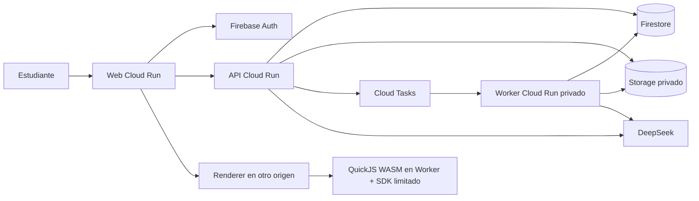

# Arquitectura y contratos de la v1

Estado actualizado al 11 de noviembre de 2026: este documento conserva la arquitectura objetivo y contratos de la planeación original. H0–H2 ya están implementados; los registros de cierre y ADR describen el alcance real y sus ajustes. Los contratos ejecutables se generan desde el backend; sus cambios deben actualizar consumidores y pruebas en la misma entrega. Consultar [el contexto vigente](../CONTEXTO.md).

La propuesta original alojaba todos los componentes en Cloud Run. Para el acceso remoto solicitado se recomendó después Firebase Hosting para web y renderer, siempre en orígenes separados, con API/worker en Cloud Run. Esa configuración aún no está implementada: el trabajo quedó pausado hasta aviso del usuario sobre facturación activa. Las tablas y diagramas originales siguientes expresan el objetivo inicial, no infraestructura existente.

## 1. Elección de arquitectura

Se propone un monolito modular con API y worker desplegados por separado. Comparten dominio y contratos, pero el procesamiento de documentos no bloquea el servicio de navegación. Frente a una VM única, reduce operación manual y permite demostrar servicios cloud; frente a microservicios por funcionalidad, evita transacciones distribuidas innecesarias.

| Componente | Propuesta | Función |
|---|---|---|
| Web | React, TypeScript, Vite, CSS con tokens | Interfaz, navegación, accesibilidad; sin necesidad de SSR en v1 |
| API | Python, FastAPI, Pydantic | Autorización, dominio, chat, generación de contratos OpenAPI |
| Worker | Mismo paquete Python, entrada separada | Extracción, visión, generación, borrado y recomputación |
| Identidad | Firebase Authentication | Google y correo/contraseña; solo cuentas internas autorizadas |
| Metadatos | Firestore Native | Perfil, organización, trabajos, conversaciones y evidencia |
| Archivos | Cloud Storage privado | Originales, páginas, índices y paquetes de recursos versionados |
| Trabajos | Cloud Tasks → Cloud Run privado | Entrega con reintentos y autenticación de servicio |
| Hosting | Cloud Run: web, API, worker, renderer | Contenedores; renderer en origen separado sin datos de usuario |
| IA | Adaptador DeepSeek del servidor | Texto, visión, respuestas y generación estructurada |
| Operación | Secret Manager, Logging, Monitoring, Artifact Registry | Secretos, métricas, alertas e imágenes de contenedor |
| Infraestructura | Terraform + comandos documentados | Provisionamiento reproducible, revisión del plan antes de aplicar |

Elegir versiones estables y compatibles al ejecutar T01; fijarlas en lockfiles. No copiar versiones supuestamente actuales de un plan. Se consultaron las bases oficiales de [Vite](https://vite.dev/guide/) y [FastAPI](https://fastapi.tiangolo.com/) como soporte de esta propuesta.



## 2. Organización del repositorio prevista

Los archivos siguientes son destinos futuros; este plan no los crea.

```text
apps/web/src/
  app/                       rutas, proveedores, shell
  features/{auth,onboarding,home,subjects,agenda,materials,tutor,
            resources,practice,progress,passport,friends,settings}/
  components/                componentes compartidos accesibles
  styles/                    tokens, tipografía, layouts
apps/renderer/src/
  shell.ts                   aplicación confiable en origen aislado
  runtime.worker.ts          VM QuickJS sin APIs nativas expuestas
  policy/                    HTML, CSS, mensajes y cuotas
  bridge/                    operaciones visuales permitidas
packages/api-client/         tipos y cliente TS generados; no editar a mano
packages/resource-sdk/       protocolo, tipados y utilidades del sandbox
packages/design-tokens/      tokens compartidos con renderer
backend/src/campus/
  api/                       main, dependencias, rutas y manejo de errores
  domain/                    modelos/reglas, sin SDK cloud
  services/                  casos de uso
  ports/                     protocolos de almacenamiento, cola y proveedor
  adapters/                  Firebase, Firestore, GCS, Tasks, DeepSeek
  worker/                    entrada HTTP, handlers y reconciliación
  prompts/                   prompts versionados y esquemas de salida
backend/tests/{unit,integration,security}/
tests/{e2e,fixtures,ai_eval,visual}/
infra/terraform/{modules,environments/pilot}/
scripts/                     desarrollo, contratos, demo y validación
docs/{adr,runbooks,evidence}/
```

Los módulos de dominio son: identity, academic, materials, tutoring, resources, assessment, learning, social y jobs. Sus servicios consumen interfaces; no importan rutas HTTP ni componentes web.

## 3. Contratos comunes

- IDs opacos generados por servidor; `Id = string` en JSON. Nunca derivar permisos del formato del ID.
- Fechas persistidas en UTC ISO 8601; el perfil guarda zona IANA, inicialmente `America/Mexico_City`. Horario semanal conserva hora local y zona; pendientes de día completo usan fecha sin conversión a medianoche UTC.
- Respuestas paginadas: `Page<T> { items: T[], nextCursor: string | null }`, máximo 50 elementos; cursor validado y ligado al filtro.
- Errores: `ApiError { code, message, requestId, details? }`. `details` contiene errores de campos o un retry-after; no stack, prompts, headers ni contenidos privados.
- `401` sin sesión válida, `403` cuenta fuera del piloto, `404` recurso ausente o ajeno, `409` conflicto de versión/idempotencia, `413` límite de archivo, `422` entrada inválida, `429` cuota, `503` dependencia no disponible.
- Mutaciones de generación, envío de respuesta y creación de intento aceptan `Idempotency-Key` por usuario + ruta + hash de payload; mismo contenido devuelve el resultado original, distinto contenido produce `409`.
- Entidades editables llevan `revision: int`; actualizaciones incluyen `expectedRevision`. No sobreescribir silenciosamente cambios de otra pestaña.
- `ownerId`, permisos, roles, timestamps y resultados se asignan en servidor. Esquemas rechazan campos extra en mutaciones sensibles.
- Eventos: `DomainEvent { eventId, schemaVersion: 1, ownerId, type, entityId, occurredAt, payload }`. Duplicados no duplican evidencia ni recompensas.

Localizadores de página y diapositiva empiezan en 1 y representan posición física; la numeración impresa, si existe, es una etiqueta adicional. Una cita a “página 3” no debe abrir el cuarto elemento de un array por confusión de índices.

### Puertos que se congelan en T02

Los nombres siguientes son el contrato interno de colaboración; las implementaciones pueden introducir helpers privados sin alterar consumidores. Métodos de I/O asíncronos; DTOs derivados de Pydantic, no diccionarios de forma libre.

```text
Actor = { uid: Id, pilotEnabled: bool }
JobRef = { ownerId: Id, jobId: Id }
JobSpec = { kind: JobKind, entityId: Id, inputVersion: str, payload: JsonObject }
RetrievedBlock = { sourceRef: SourceRef, text: str, score: float }
TutorContextV1 = { actor: Actor, subjectId: Id, personalityId: str,
                  assistanceMode: AssistanceMode, sourcePolicy: SourcePolicy,
                  preferences: JsonObject, conversationSummary: str,
                  recentMessages: Message[], sources: RetrievedBlock[] }
ProviderEvent = { type: delta | usage | completed, text?: str, usage?: Usage }

Authorization.require_owner(actor: Actor, resourceOwnerId: Id) -> None
Authorization.require_share(actor: Actor, shareId: Id) -> ShareGrant
JobService.create(actor: Actor, spec: JobSpec, idempotencyKey: str) -> Job
JobService.cancel(actor: Actor, ref: JobRef) -> Job
JobQueue.enqueue(ref: JobRef, dispatchKey: str) -> None
ObjectStore.put(key: str, bytes: Binary, mediaType: str,
                expectedGeneration?: str) -> ObjectVersion
ObjectStore.get(key: str, generation?: str) -> Binary
ObjectStore.delete(key: str, generation?: str) -> None
Retriever.search(actor: Actor, subjectId: Id, query: str,
                 materialIds: Id[], topK: int = 8) -> RetrievedBlock[]
TutorProvider.stream_answer(context: TutorContextV1) -> AsyncIterator<ProviderEvent>
TutorProvider.generate_structured(schemaId: str, context: JsonObject) -> JsonObject
TutorProvider.transcribe_images(images: ImageInput[], context: JsonObject) -> Transcription
AssessmentService.submit(actor: Actor, attemptId: Id,
                         idempotencyKey: str) -> AttemptResult
LearningService.ingest(event: DomainEvent) -> None
```

Los repositorios son específicos de entidad y reciben `Actor`/scope; no se expone un `get_by_id` global a rutas sin autorización. `ObjectStore` es un puerto de infraestructura privado: sus claves se resuelven en servicios autorizados, no se aceptan desde peticiones de navegador. `generate_structured` acepta únicamente schemas registrados; no esquemas arbitrarios enviados por un documento.

## 4. Modelo de datos y privacidad

| Entidad | Campos esenciales | Ubicación/límite de acceso |
|---|---|---|
| Profile | displayName, career?, timezone, preferences, onboarding | `users/{uid}`; propietario |
| Period | name, startDate?, endDate? | `users/{uid}/periods/{id}` |
| Subject | name, periodId?, illustrationId, accentId, archivedAt? | `users/{uid}/subjects/{id}` |
| Topic | subjectId, title, order, prerequisiteIds[] | `users/{uid}/topics/{id}`; prerrequisitos misma materia, sin ciclos |
| AgendaItem | subjectId?, kind, title, dueDate?/dueAt?, status | `users/{uid}/agenda/{id}` |
| ScheduleBlock | subjectId, weekday, localStart, localEnd, timezone | `users/{uid}/schedule/{id}`; excepciones en subcolección |
| Material | subjectId, mediaType, objectKey, sha256, status, extractionVersion | `users/{uid}/materials/{id}` |
| SourceBlock | materialId, extractionVersion, page?/slide?/section, text, reviewStatus | cuerpos en GCS privado, referencias en índice |
| Conversation | subjectId, title, personalityId, assistanceMode, sourceSelection | `users/{uid}/conversations/{id}` |
| Message | role, text, citations[], status, resourceIds[], modelTraceId? | subcolección messages; paginar, no arrays ilimitados |
| Resource | subjectId, kind, title, currentVersionId, sourceRefs[], status | `users/{uid}/resources/{id}` |
| ResourceVersion | version, packageKey, schemaVersion, validation, sourceRefs | subcolección versions; inmutable al publicar |
| ResourceState | resourceVersionId, state, revision | `users/{uid}/resourceStates/{id}`; nunca resultado académico |
| Assessment | subjectId, topicIds, itemIds, version, sourceRefs | `users/{uid}/assessments/{id}`; soluciones separadas |
| Attempt | assessmentId, version, answers, assistance, status, results | `users/{uid}/attempts/{id}`; servidor calcula resultados |
| ReviewCard | resourceId, front, back, dueAt, scheduleState | `users/{uid}/reviewCards/{id}` |
| LearningEvidence | attemptId?, topicId, mode, outcome, confidence, timestamp | `users/{uid}/evidence/{eventId}`; append-only por servidor |
| TopicProgress | topicId, level, confidence, evidenceCount, updatedAt | `users/{uid}/progress/{topicId}`; derivable |
| StudySession | activityId, intervals, status | `users/{uid}/sessions/{id}`; intervalos compactados |
| Job | kind, status, stage, progress, attempts, leaseUntil, resultRef, error | `users/{uid}/jobs/{id}` |
| AchievementDefinition | key, version, title, artId?, rule, active, demoOnly | catálogo del servidor, no editable por IA |
| AchievementAward | definitionKey, version, evidenceIds[], earnedAt | `users/{uid}/awards/{id}`; único por definición/regla |
| Friendship | participantIds[2], state, blockedBy? | `friendships/{id}`; solo participantes |
| FriendInvite | tokenHash, issuerId, expiresAt, usesRemaining | colección privada del servidor, nunca listado público |
| Share | ownerId, recipientId, resourceVersionId, snapshotKey, revokedAt? | `shares/{id}`; propietario y receptor con amistad activa |
| Challenge | ownerId, invitedIds, acceptedIds, rule, startsAt, endsAt | `challenges/{id}`; participantes autorizados |

Compartir un pasaporte utiliza una proyección calculada, no acceso a `users/{otro}`. La proyección filtra campos según preferencias y relación activa. Recurso compartido es snapshot explícito de una versión; solo estado propio del receptor se puede editar. Copia/descarga del código del autor no es requisito de v1.

El snapshot público al receptor usa `SharedResourceView { shareId, title, kind, package, sourceLabels: string[] }`; no reutiliza el DTO privado de Resource con claves GCS, owner paths, citas/extractos ni IDs de materiales. El código de un recurso que se ejecuta en el navegador es técnicamente inspeccionable: la ausencia de botón de descarga no es protección del código.

Flujo de amistad definido: A crea su código, B lo canjea y se crea solicitud pendiente B→A; A acepta o rechaza. El canje no concede amistad ni acceso por sí mismo. El código no se usa para autenticarse ni para leer perfil privado.

Todos los accesos de datos de producto pasan por API; reglas Firestore y Storage del cliente deniegan lectura/escritura directa. Admin SDK ignora reglas cliente: por ello cada servicio/repository debe verificar propietario o concesión antes de leer cuerpos privados. [Firebase documenta la verificación de ID tokens en backend](https://firebase.google.com/docs/auth/admin/verify-id-tokens).

Índices iniciales: materias por archivo/fecha; agenda por estado/fecha; materiales y recursos por materia/creación; trabajos por estado/actualización; evidencia por tema/fecha; amistades por participante/estado. Declararlos en infraestructura; no crear consultas amplias que luego filtren en cliente.

## 5. API pública de la aplicación

Prefijo `/api/v1`. El actor se deriva de `Authorization: Bearer <Firebase ID token>` validado; tokens no se pasan por URL. El SSE se consume con `fetch`, no con EventSource que obligue a poner el token en query.

| Área | Operaciones mínimas y resultado |
|---|---|
| Identidad | `GET/PATCH /me`, `POST /me/onboarding-events`, `DELETE /me` → Job |
| Académico | CRUD `/periods`, `/subjects`, `/subjects/{id}/topics`, `/agenda`, `/schedule`; archivar vía PATCH, borrar sujeto vía Job |
| Catálogo | `GET /catalog/illustrations`, `/catalog/personalities`, `/catalog/achievements` con filtros de demo |
| Carga | `POST /subjects/{id}/uploads` → UploadTicket; `POST /uploads/{id}/complete` → Material + Job |
| Material | listar/leer, `PATCH /materials/{id}/transcript` → nueva extracción + Job, `DELETE /materials/{id}` → Job |
| Trabajos | `GET /jobs/{id}`, `POST /jobs/{id}/cancel`, `POST /jobs/{id}/retry` |
| Chat | crear/listar conversaciones; `POST /conversations/{id}/turns` → TurnAccepted; `GET /turns/{id}/events?after=...`; `GET /turns/{id}` para recuperar estado |
| Recursos | `POST /subjects/{id}/resources` → Job; listar/leer; `POST /resources/{id}/versions` → Job; leer/escribir `/resources/{id}/state` por versión |
| Fuentes | `GET /materials/{id}/pages/{locator}` → vista autorizada; no recibe URL remota arbitraria |
| Práctica | crear instrumento mediante Job; `POST /assessments/{id}/attempts`; `POST /attempts/{id}/answers`; `POST /attempts/{id}/hints`; `POST /attempts/{id}/reveal`; `POST /attempts/{id}/submit` |
| Tarjetas | `GET /reviews/due`, `POST /reviews/{id}/grade` con autoevaluación 0–3 |
| Aprendizaje | `POST /study-sessions`, heartbeat/cierre; `GET /subjects/{id}/progress`, `GET /recommendations`, `POST /recommendations/{id}/dismiss` |
| Social | crear/revocar invitación; canjear código → solicitud; aceptar/rechazar/eliminar/bloquear amistad; `GET /friends/{id}/passport`; CRUD retos por capacidades |
| Compartir | `POST /resources/{id}/shares` con receptor y versión; `GET/DELETE /shares/{id}` |

Contratos estructurados principales:

```text
SourceRef = { materialId, extractionVersion, blockId, locator, quote? }
SourcePolicy = { mode: "selected_material" | "general", materialIds: Id[],
                 allowGeneralForTurn: boolean }
UploadTicket = { uploadId, materialId, signedUrl, requiredHeaders, expiresAt }
TurnAccepted = { turnId, status: "queued", eventsUrl }
JobStatus = queued | running | needs_review | succeeded | failed |
            cancel_requested | canceled
MaterialStatus = uploading | queued | processing | needs_review |
                 ready | partial | failed | deleting
ResourceKind = summary | concepts | flashcards | quiz | interactive
AssistanceMode = explain | hints | solution | practice
AssessmentOutcome = { itemId, status: correct | partial | incorrect | ungraded,
                      score?, evaluation: deterministic | ai_provisional,
                      feedback, sourceRefs[] }
```

`allowGeneralForTurn` vuelve a falso en cada turno salvo que el usuario cambie explícitamente el modo de fuentes de la conversación. No se hereda autorización para buscar datos privados ni navegar la web. Todos los IDs de fuentes y temas se verifican dentro de la materia actual.

## 6. Archivos y extracción

Defaults iniciales, configurables sin cambiar contratos: documento 20 MiB, imagen 10 MiB, hasta 200 páginas/diapositivas por material, 30 megapíxeles por imagen decodificada, 500 MiB almacenados por cuenta de piloto. Son límites de protección y prueba, no cuotas comerciales acordadas.

1. API valida cuenta, materia, cuota y formato declarado. Crea ticket de 10 minutos y clave aleatoria bajo `private/{uid}/materials/{materialId}/original`.
2. Carga firmada de objeto exacto y cabeceras; no permitir elegir bucket/ruta. El cliente no puede elegir owner. Las [URLs firmadas](https://docs.cloud.google.com/storage/docs/access-control/signed-urls) dan acceso temporal a quien las posea: no registrarlas ni compartirlas en telemetría.
3. Al completar, servidor verifica existencia, generación del objeto, tamaño y tipo real; el worker valida contenido antes de usarlo. Lo inválido se elimina. La validación posterior no evita todo abuso durante el upload: ticket, cuota, caducidad y limpieza limitan exposición.
4. PDF textual: extracción por página; PPTX: texto y notas por diapositiva, rasterización de figuras cuando sea necesaria; imágenes/PDF escaneado: visión con recortes de fórmulas. Conversiones con argumentos fijos, sin shell, límites de memoria/tiempo, sin macros ni acceso a red.
5. Procesar en lotes de páginas para que cada tarea termine dentro de su plazo; checkpoint por página. Nunca enviar un documento enorme entero en cada pregunta.
6. Construir índice por materia y versión. Fuente dudosa → `needs_review`, no `ready` silencioso. Una página no legible no invalida automáticamente todo el archivo: UI distingue cobertura parcial.

Se propone PyMuPDF para PDF sujeto a revisión de licencia antes de adoptarlo; si no es compatible con la distribución elegida, usar pypdf + rasterizador con licencia compatible. PPTX con python-pptx y conversión aislada de LibreOffice cuando haga falta fidelidad de figuras. T01 registra licencias y T04 elige la combinación con evidencia, sin fijar una dependencia incompatible por comodidad.

## 7. Recuperación y proveedor IA

`TutorProvider` expone `stream_answer(context)`, `generate_structured(schema, context)` y `transcribe_images(images, context)`. Su implementación recibe secretos del servidor; el cliente nunca llama a DeepSeek directamente. Un proveedor falso implementa la misma interfaz para tests.

La documentación consultada el 2 de noviembre de 2026 indica que `deepseek-flash` admite texto e imágenes y formatos JPEG/PNG/GIF/WebP. Es base válida para experimentar con apuntes e imágenes; la precisión matemática debe comprobarse. Modelo/base URL se configuran y revalidan al implementar. [Documentación oficial de visión](https://api-docs.deepseek.com/guides/vision/).

Primera recuperación: índice léxico BM25 por materia con normalización de términos, encabezados y expresiones. Se almacena como JSON comprimido en GCS, no pickle; caché acotada por owner+materia+versión. El buscador aplica filtros de propietario y fuente ANTES de recuperar. Devuelve bloques con `SourceRef`, no solo texto.

No se presupone que DeepSeek ofrezca embeddings. Se diseña `Retriever` como puerto reemplazable. Si T04 no supera el umbral de recuperación, se prueba expansión de consulta con el mismo proveedor; si sigue fallando, se documenta y selecciona otro adaptador antes de avanzar. La incorporación de un proveedor nuevo con costo/datos diferentes requiere revisar esa decisión, no ocultarla.

El contexto incluye fuentes recuperadas, preferencias relevantes, resumen de conversación y últimos turnos dentro de un presupuesto. Fuentes/documentos son datos no confiables; no pueden alterar políticas, herramientas o scope. El servidor verifica que las citas referencien bloques realmente incluidos y que sus extractos existan; una cita válida estructuralmente aún necesita evaluación de fidelidad semántica.

Salidas JSON se validan con Pydantic; máximo dos intentos de reparación en trabajo de generación, luego fallo explícito. No evaluar strings como código Python, expresiones arbitrarias ni instrucciones de herramienta. Prompts y esquemas tienen versión para reproducibilidad. Registrar consumo y latencia, no contenidos privados.

## 8. Trabajos, turnos y consistencia

`Job` es la fuente de verdad, Cloud Tasks es transporte. API crea Job + evento de outbox en transacción Firestore, intenta despachar y devuelve ID estable. Un reconciliador programado mediante Cloud Scheduler invoca un endpoint privado que reintenta outbox pendiente y detecta leases vencidos. El Scheduler se configura en infraestructura y se incluye en costos; en local se invoca manualmente mediante script.

Task HTTP lleva únicamente referencia al trabajo y firma OIDC del service account de invocación. Worker privado valida invocador y carga el job almacenado. [Cloud Tasks documenta destinos HTTP autenticados](https://docs.cloud.google.com/tasks/docs/creating-http-target-tasks).

Worker adquiere lease transaccional; las salidas usan claves por job+etapa+versión. Deduplicación propia además del nombre determinista de task. Retries transitorios con backoff, máximo cinco entregas configuradas; el handler decide si el error de proveedor admite reintento. Error de validación no se reintenta. El reconciliador marca fallo terminal cuando se agotaron intentos; no se supone una cola de errores automática.

Un lease perdido no autoriza publicar resultados; se verifica versión antes de commit. Cancelar es cooperativo: detiene etapas futuras y descarta resultado tardío, pero una llamada ya iniciada puede haber consumido dinero. Los efectos externos no son exactamente una vez: un timeout después de respuesta de IA puede obligar a repetir costo. Registrar este caso y limitarlo, sin afirmar garantías imposibles.

Transiciones válidas: `queued→running`; `running→succeeded/needs_review/failed/queued` (el último solo por reintento transitorio); `queued/running/needs_review→cancel_requested→canceled`. Un trabajo en `needs_review` libera lease y no se reintenta automáticamente. Al corregir transcripción se crea nueva versión/job y el anterior se cancela como `superseded`; aprobar los bloques ya revisados puede reanudar el mismo job en `queued`. Reintentar un fallo terminal crea job nuevo ligado al anterior y no sobreescribe resultados históricos. `partial` corresponde a un material utilizable con páginas fallidas/omitidas explícitas; las preguntas deben advertir cobertura incompleta.

Chat usa jobs de tipo `tutor_turn`: worker genera, persiste texto final y checkpoints moderados; API transmite SSE desde buffer/checkpoints acotados. No escribir cada token a Firestore. Eventos `queued`, `started`, `delta`, `citation`, `resource_job`, `completed`, `failed` con secuencia creciente. Tras desconexión, `GET /turns/{id}` recupera respuesta; el trabajo sobrevive. Buffer/cursores no garantizan replay de cada token, sí recuperación del texto acumulado sin duplicación visual.

Reserva de cuota por trabajo antes de llamar IA; ledger de uso final por requestId. Reintento y timeout ajustan consumo observado/conservador. Límites iniciales: dos trabajos IA activos por cuenta, dos cargas simultáneas, 20 turnos/minuto y límite diario configurable de tokens/costo. El operador debe definir el presupuesto diario del piloto antes de habilitar proveedor real; desarrollo usa una configuración explícita de pruebas, nunca ilimitado por defecto.

## 9. Laboratorio: aislamiento con capacidades

### Decisión de diseño

Un iframe con `sandbox` y CSP no basta para garantizar que JavaScript arbitrario no navegue su propia página o filtre información. Por eso el HTML generado no ejecuta scripts nativos. La propuesta es interpretar JavaScript con QuickJS compilado a WASM dentro de un Web Worker; solo se exponen funciones del SDK mediante valores JSON. El wrapper documenta límites de memoria e interrupción; hay que validar la integración propia, no asumir que la librería certifica toda la aplicación. [QuickJS](https://bellard.org/quickjs/) y [quickjs-emscripten](https://github.com/justjake/quickjs-emscripten).

### Paquete de recurso

```text
InteractivePackageV1 = {
  schemaVersion: 1,
  title: string,
  learningObjective: string,
  instructions: string,
  html: string,
  css: string,
  javascript: string,
  initialState: JsonObject,
  textAlternative: string,
  sourceRefs: SourceRef[],
  requestedCapabilities: ("controls" | "math" | "plot" | "canvas2d" | "state")[]
}
```

El renderer es un shell estático confiable en otro origen, sin cookies de autenticación, rutas de datos ni secretos. El padre obtiene el paquete autorizado de API y lo manda a ese shell por un canal explícito. El iframe usa `allow-scripts allow-same-origin` SOLO porque carga un origen diferente controlado y necesita workers/activos propios; nunca usar esa combinación con HTML generado servido desde el origen de la aplicación. No permitir top navigation, popups, downloads ni forms. El código generado no llega a `<script>`, `eval` ni `new Function` del navegador.

HTML admite elementos de texto, disposición y controles; elimina scripts, eventos inline, enlaces navegables, formularios, iframes, embeds, objetos, SVG/MathML crudos y atributos URL. CSS se analiza con parser, no regex: bloquear import, url, fuentes remotas y construcciones fuera de límites. SVG y fórmulas solo los producen las bibliotecas confiables mediante comandos del SDK. Tokens visuales se inyectan por shell.

El código interpretado no recibe `window`, `document`, `fetch`, sockets, storage, cookies, imports externos ni callbacks/objetos host. Solo JSON serializable cruza el puente. No heredar propiedades/prototipos del host. CSP del renderer restringe recursos a sus activos propios y capacidades WASM necesarias; la aplicación principal prohíbe su propio framing. Políticas y límites se verifican con pruebas reales del navegador; referencias: [iframe](https://developer.mozilla.org/en-US/docs/Web/HTML/Reference/Elements/iframe) y [CSP](https://developer.mozilla.org/en-US/docs/Web/HTTP/Reference/Headers/Content-Security-Policy).

### SDK mínimo, abierto en composición

```text
ui.on(elementId, eventName, handler)          eventos de click/input/change
ui.patch(elementId, {text?, value?, classes?, attributes?})
ui.mount(elementId, SafeNodeSpecV1[])        nodos nuevos por esquema, sin HTML activo
ui.renderMath(elementId, latex)              render confiable, sin HTML arbitrario
ui.plot(elementId, PlotSpecV1)               series/axes/domains/labels, no JS callbacks
ui.draw(elementId, CanvasCommandsV1[])       comandos numéricos acotados
ui.animate(handler, {maxFps})                ticks suministrados por host, cancelable
state.read() / state.write(JsonObject)      solo estado de esa versión
host.requestPractice({topicId})             petición visible; no concede resultado
```

Las APIs no son plantillas: permiten composiciones, algoritmos y explicaciones nuevas. `ui.patch` solo permite atributos definidos por esquema; no `innerHTML`/URLs/event handlers. Validar que cada elemento pertenece a la raíz del recurso. Funciones `handler` viven dentro de VM, el host solo maneja identificadores opacos.

`SafeNodeSpecV1` describe tag permitido, ID local, atributos permitidos, texto y descendientes; al montar se vuelven a aplicar cuotas y las mismas reglas de markup inicial. No se transportan nodos DOM ni referencias a objetos JavaScript del host.

Protocolo externo: `{protocolVersion:1, channelId, sequence, type, payload}`. Handshake con nonce criptográfico y `event.source`, `event.origin` exacto del renderer; `targetOrigin` exacto. Rechazar replay, mensajes grandes y tipos desconocidos. El padre solo permite cargar, resetear, guardar estado acotado y solicitar práctica; no ofrece una API genérica HTTP.

Límites iniciales: paquete 300 KiB, estado 50 KiB, 1.000 nodos, 32 MiB de heap de VM, 100 ms de ejecución por evento y 30 fps máximo; ráfagas de puente limitadas y Worker terminable. Medir sobrecarga WASM adicional: heap de VM no equivale a memoria total del navegador. Si falla, se muestra alternativa textual y reiniciar; no se pierde el chat.

**Puerta T03:** demostrar un explorador de función, una simulación de movimiento y una visualización de algoritmo, más corpus de ataques. Si el SDK no permite la experiencia, ampliarlo mediante capacidades revisadas. Nunca degradar a ejecutar JS arbitrario en el origen principal. Esta validación ocurre antes de comprometer toda la generación de recursos a un formato inadecuado.

## 10. Evaluación y progreso reproducible

Respuestas correctas y rúbricas se guardan en colecciones/objetos privados separados de la representación pública del instrumento. El frontend recibe enunciado y opciones, no claves. `submit_attempt` calcula el resultado desde el intento persistido; repetir submit devuelve la misma evaluación.

Número/unidades: parser acotado de decimal, notación científica y unidades permitidas; tolerancia absoluta/relativa declarada. No aceptar expresiones Python ni `eval`. Opción múltiple compara ID; respuesta abierta usa rúbrica y marca `ai_provisional`.

Propuesta inicial de dominio: calcular media ponderada de últimas 20 evidencias evaluadas del tema; independiente determinista pesa 1, asistida 0,4, IA provisional 0,25 y flashcard autoevaluada 0,1. Mostrar nivel “inicial / en desarrollo / consistente”, no porcentaje de conocimiento. “Consistente” requiere al menos cinco evidencias independientes en dos días distintos y media ≥ 0,8; “en desarrollo” al menos tres y media ≥ 0,5; resto inicial o sin evidencia. Reportar confianza baja/media/alta según cantidad y diversidad; el algoritmo es heurístico, no una medición psicométrica validada.

Última evidencia nueva sustituye a duplicados del mismo evento; reintentar una pregunta ya revelada no cuenta como independiente. Recomendaciones deterministas priorizan pendientes cercanos, errores recientes, repaso vencido y después continuación; IA redacta explicación opcional sin cambiar permisos o resultados. Dificultad cambia un nivel como máximo tras tres intentos evaluables, con umbrales de acierto documentados y tests.

Tiempo activo: heartbeat cada 30 segundos con ventana visible/actividad reciente; servidor limita intervalos al tiempo realmente transcurrido, pausa tras 2 minutos inactivos y une solapamientos de todas las pestañas por usuario. Es aproximación vulnerable a simulación del cliente: no usarla como prueba académica ni única condición de logros valiosos.

Estampillas usan un DSL de reglas permitido (`count_evidence`, `completed_practice_sessions`, `distinct_study_days`, operadores y umbrales), nunca expresiones ejecutables ni prompts. Regla y arte se versionan. Premio idempotente con referencias a evidencia; cambiar catálogo no borra premios históricos automáticamente.

## 11. Eliminación, retención y operación

- Borrar material revoca primero acceso y nuevas recuperaciones; luego job borra original, páginas, chunks e índices. Chats/recursos derivados contienen contenido de la fuente: por defecto eliminar también sus versiones derivadas y shares asociados; la UI enumera el impacto antes de confirmar. No prometer privacidad manteniendo copias derivadas inadvertidas.
- Borrar materia elimina contenido descendiente y retira referencias de recomendaciones/agenda; los elementos ajenos a esa materia no se tocan. Borrar cuenta revoca acceso primero y elimina relaciones, contenido y Auth al final del job.
- La evidencia dependiente de contenido eliminado se retira y se recomputa progreso, retos y premios afectados; el diálogo de impacto lo explica. No conservar extractos privados en premios como atajo de auditoría. Cambiar solo el catálogo artístico no implica este borrado.
- Jobs de borrado son idempotentes con tombstone; reintentos no reactivan datos. Evitar carreras con trabajos de generación mediante comprobación de tombstone antes del commit.
- Objetos de cargas incompletas: limpieza tras 24 h. Temporales de extracción: 24 h tras resultado final. Logs operativos sin contenido: retención objetivo 30 días configurable. Política real de soft-delete de GCS se documenta y se refleja en “borrado lógico vs eliminación física”; no prometer borrado instantáneo si el proveedor retiene versiones.
- No habilitar backup/PITR por defecto como si fuera gratuito. Para demo, script de exportación/restauración de datos sintéticos y procedimiento de recuperación; datos valiosos reales requieren decidir política de respaldo antes de abrir el piloto a terceros.

## 12. Cloud, costos y ambientes

Local: Auth/Firestore emulators, adaptadores de archivos/cola locales y DeepSeek falso; tests de Cloud Storage/Tasks reales quedan en suite de staging. No asumir un emulador oficial de cada servicio. Scripts deben funcionar desde PowerShell; contenedores Linux se documentan como prerrequisito cuando haya rasterizadores.

Piloto: un proyecto GCP, región propuesta `us-central1` por compatibilidad de servicios y free tier de Storage; confirmar residencia/latencia antes de crear recursos. Firestore ubicación coherente. Cloud Run min instances 0; API max 2, worker max 1 y concurrencia acotada; cola inicialmente dos despachos concurrentes ajustados a capacidad real. La latencia de arranque en frío se mide, no se presenta como fallo oculto.

No hay trial. Free Tier exige cuenta de facturación y tiene cuotas/condiciones; las alertas de presupuesto no detienen el gasto. Medir Run, Storage, Firestore, Tasks, Scheduler, Artifact Registry, tráfico, builds, logs y Secret Manager. No prometer costo cero ni asumir que todos son gratis. Fuentes: [Free Tier](https://docs.cloud.google.com/free/docs/free-cloud-features), [presupuestos](https://docs.cloud.google.com/billing/docs/how-to/budgets), [cuotas Firestore](https://firebase.google.com/docs/firestore/quotas).

Identidades separadas para API, worker, invocación de Tasks y despliegue. Permisos mínimos por bucket/cola/servicio; conceder `actAs` solo donde corresponda. Sin llaves JSON de service account en repositorio. DeepSeek en Secret Manager; CI futuro mediante identidad federada si se conecta un repositorio. Terraform state remoto privado con versionado y permisos restringidos; bootstrap y costos se explican antes del primer apply.

Cloud Run web/API pueden ser alcanzables por internet: endpoints de producto verifican token + lista de cuentas piloto. Worker y reconciliación no admiten invocación anónima. Renderer es público estático y no tiene acceso a datos ni APIs internas.

Métricas: latencia API/primer contenido, errores por dependencia, jobs pendientes/antiguos, fallos de extracción, citas inválidas, reparaciones de JSON, tokens/costo estimado, violaciones de sandbox y consumo cloud. RequestId/JobId unen trazas; no registrar texto de chat, archivos, prompts completos, URLs firmadas o tokens.

## 13. Seguridad: estado de esta planeación

Security check:
- Data touched: solo documentos de planificación y referencias a imágenes locales; no datos de estudiantes.
- Auth required: propuesta Firebase + lista de piloto; no implementada ni probada.
- Authorization enforced at: prevista en API/servicios y worker; aislamiento por usuario pendiente de pruebas A/B/C.
- Secrets: ninguno leído o creado; Secret Manager previsto.
- Input validation: contratos y límites especificados; ejecución pendiente.
- Output rendering: separación runtime/DOM y sanitización previstas; puerta T03 obligatoria, sin certificación actual.
- Logs/errors: política de redacción definida; no existen logs de aplicación todavía.
- DB/storage rules: denegación cliente y autorización servidor diseñadas; reglas aún no creadas.
- Dependencies: propuestas sujetas a versión/licencia/auditoría en T01; ninguna instalada en esta etapa.
- Rate limiting / abuse controls: cuotas, reservas, límites de cola y allowlist especificados; no aplicados todavía.
- Web risks: pruebas de CORS, redirecciones, SSRF, XSS, framing y tokens especificadas; sin cookies de sesión propias en esta propuesta.
- Prototype/security debt: no se declara una aplicación segura; los controles son trabajo futuro con criterios de cierre.
