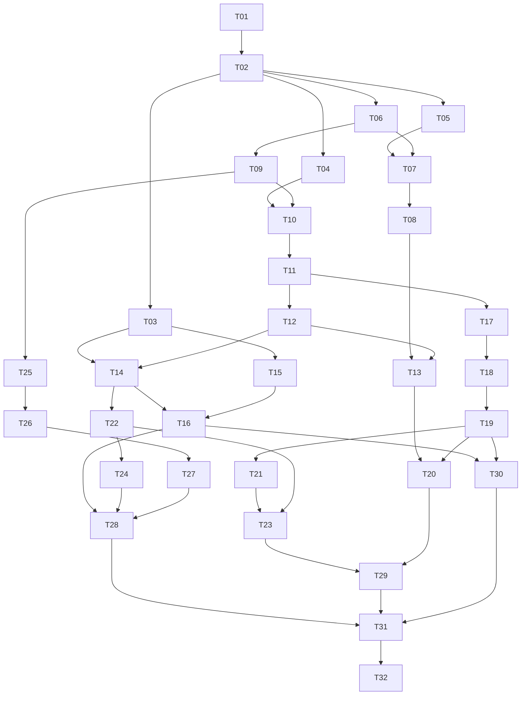

# Plataforma de estudio con IA v1.0 — Implementation Plan

> **For agentic workers:** REQUIRED SUB-SKILL: Use superpowers:subagent-driven-development (recommended) or superpowers:executing-plans to implement this plan task-by-task. Steps use checkbox (`- [ ]`) syntax for tracking.

**Goal:** entregar una plataforma universitaria funcional para piloto interno que organice materias libres, transforme material propio en tutoría y recursos interactivos, registre evidencia de aprendizaje y permita un pasaporte privado entre amigos.

**Architecture:** monolito modular con API y worker separados en Cloud Run; Firestore y Storage privados; Cloud Tasks para trabajos; DeepSeek detrás de un adaptador; laboratorio en origen independiente con JS interpretado y SDK acotado.

**Tech Stack:** propuesta React/TypeScript/Vite, Python/FastAPI/Pydantic, Firebase Auth, GCP, Terraform, Playwright, Vitest y pytest. Versiones/licencias se fijan al comenzar, no en esta planeación.

**Spec:** [diseño de producto](../specs/2026-11-02-plataforma-estudio-design.md), [arquitectura y contratos](../../planning/arquitectura-y-contratos.md), [validación](../../planning/validacion-y-demo.md), [coordinación](../../planning/subagentes.md).

**Estado:** todas las tareas pendientes de autorización de implementación. Este archivo es un plan, no evidencia de trabajo terminado. La autorización actual abarca solo documentos.

## Global Constraints

- Mantener alcance y decisiones de producto de la especificación. Los mockups no fijan nombres de materias ni estampillas. Materias libres con catálogo de ilustraciones; estampillas definitivas pendientes.
- Home organizador y chat cerrado por defecto. No imponer personalidad/modo de ayuda ni diagnóstico obligatorio.
- Prioridad de fuentes del usuario, trazabilidad por página/bloque, consentimiento para ampliar conocimiento y aislamiento entre cuentas.
- No exponer credenciales, no ejecutar JS generado en navegador principal/servidor, no confiar en calificaciones del cliente o recurso.
- Modelo y formatos de DeepSeek se verifican contra documentación al implementar. La visión forma parte del alcance.
- No prometer infraestructura gratuita ilimitada. Planear con free tier, sin crédito trial; medir antes de proponer gasto adicional.
- Cada subagente edita solo archivos asignados. Contratos, lockfiles, rutas globales e infraestructura compartida tienen propietario único.
- No implementar funciones futuras para “dejar preparado” un marketplace, comunidad pública, plataforma multiinstitución o editor de código remoto.
- Datos de pruebas sintéticos/licenciados; no logs privados. No añadir datos demo al catálogo real sin acción explícita.
- No ejecutar en esta etapa scaffolds, instalación, tests de aplicación, git init, llamadas pagadas al modelo ni despliegues. Los comandos siguientes son instrucciones futuras.

## Review Focus

1. **Fuga de material entre cuentas o amistades:** revisar cada ruta/repository y ejecutar V16/V17/V19/V21/V22 con tres identidades.
2. **Código generado obtiene capacidades no previstas:** T03 y T15 prueban host-object leakage, red, navegación, CSS/HTML y límites; no aceptar fallback inseguro.
3. **Trabajo duplicado o perdido:** T09/T12/T24 validan outbox, lease, replay, cancelación y borrado durante generación; métricas deben revelar trabajos atascados.
4. **Progreso convincente pero falso:** T17/T19/T21 verifican grading servidor, ayuda, duplicados, autoevaluación, incertidumbre y minutos solapados.
5. **Tutor correcto visualmente pero infiel a los apuntes:** T04/T11/T30 comprueban páginas, símbolos, recuperación, citas y casos sin respuesta con DeepSeek real.

## 1. Hitos y orden de construcción

| Hito | Resultado demostrable | Tareas principales | Puerta de salida |
|---|---|---|---|
| H0 · Base y riesgos | Entorno reproducible y viabilidad del runtime/documentos | T01–T04 | Contratos iniciales + spikes con evidencia |
| H1 · Espacio académico | Entrar, crear materias y ver agenda/inicio | T05–T08 | V01–V03, aislamiento base |
| H2 · Material y tutor | Subir, procesar, preguntar y abrir una cita | T09–T13 | V04–V09, recuperación mínima |
| H3 · Recursos | Generar, manipular, guardar y versionar | T14–T16 | V10–V11, sandbox probado |
| H4 · Aprendizaje | Practicar, revisar y recibir recomendaciones | T17–T20 | V12–V15, onboarding contextual |
| H5 · Pasaporte privado | Motor de estampillas, amistad, retos y shares | T21–T23 | V16–V18/V23, catálogo demo separado |
| H6 · Operación cloud | Borrado, despliegue, métricas y recuperación | T24–T27 | V19–V22, IAM y límites reales |
| H7 · Cierre | Seguridad, visuales, evaluación y demo verificadas | T28–T32 | Matriz completa y documentación reproducible |

Los hitos describen resultados, no sprints de duración fija. T25 puede prepararse temprano cuando estén definidos los contratos de servicio; T27 empieza con un smoke mínimo y se repite solo al integrar componentes nuevos. No esperar al final para descubrir que IAM, subida firmada o worker no funcionan en GCP.

La tabla de dependencias de cada tarea es autoritativa; el diagrama resume relaciones principales. No iniciar una tarea con contrato provisional incompatible con su productor.

## 2. Convención de trabajo y comandos

En T01 se crean scripts raíz con estos nombres, para que el resto del plan no dependa de rutas informales:

| Comando previsto | Contrato |
|---|---|
| `pnpm dev` | Web/API/renderer y adaptadores locales; documenta emuladores requeridos |
| `pnpm check` | Typecheck, lint y validación de contratos; sin tests pagados |
| `pnpm test:unit` | Vitest + pytest unitarios, exit distinto de 0 si fallan |
| `pnpm test:integration` | Integraciones locales/emuladores con fixtures aislados |
| `pnpm test:e2e -- --grep Vxx` | Playwright por caso de aceptación |
| `pnpm test:security` | Corpus de seguridad backend/renderer; no placeholder verde |
| `pnpm contracts:generate` / `pnpm contracts:check` | Exportar OpenAPI y TS / detectar drift |
| `pnpm eval:ai -- --suite smoke` | Evaluación real opt-in; falla explicando credencial ausente |
| `pnpm test:cloud` | Suite opt-in contra proyecto piloto con cleanup |
| `pnpm demo:seed` / `pnpm demo:reset` | Datos sintéticos, protegidos contra ambiente equivocado |

El backend usa `uv` y `uv.lock`, frontend `pnpm` y su lockfile. Desde `backend/`, suites focalizadas: `uv run pytest tests/unit/test_<modulo>.py -q` o integración equivalente. Desde raíz, Vitest: `pnpm --filter @campus/web exec vitest run <ruta>` y renderer `@campus/renderer`. Cada tarea registra los comandos realmente utilizados; si cambia un script, actualizar esta tabla y sus consumidores.

Para comportamiento nuevo: escribir primero un caso que falle por la funcionalidad ausente, implementar lo mínimo que satisfaga el contrato y ejecutar casos afectados. No exigir tests artificiales para documentación o ilustraciones. La revisión visual y de licencias es verificación adecuada para esos activos.

Una tarea concluye con resumen de archivos, pruebas y riesgos, seguido de commit local **solo durante la ejecución y si existe repositorio**. T01 puede establecer Git cuando se autorice construir; no se crea remoto ni se hace push sin instrucción. Usar commits por tarea o unidad coherente, nunca un commit que mezcle trabajo ajeno.

## 3. Tareas ejecutables

### T01 · Preparar repositorio y entorno reproducible

**Depende de:** autorización de implementación. **Responsable:** integrador. **Tamaño:** pequeño.

**Crear:** `package.json`, `pnpm-workspace.yaml`, `pnpm-lock.yaml`, `backend/pyproject.toml`, `backend/uv.lock`, `apps/{web,renderer}/package.json`, `scripts/dev.*`, `.env.example`, `.gitignore`, `README.md`, `docs/adr/0001-stack.md`.

- [ ] Leer AGENTS y los cinco documentos del plan; comprobar el estado real del workspace antes de crear archivos.
- [ ] Elegir versiones estables compatibles de Node/Python/frameworks y registrar licencias; resolver parser PDF antes de incluirlo como dependencia de distribución.
- [ ] Crear paquetes vacíos mínimos con healthcheck, runner y scripts de la sección 2; scripts no disponibles deben fallar explícitamente, no devolver éxito sin ejecutar nada.
- [ ] Definir variables por ambiente sin secretos reales: project ID, regiones, orígenes, emuladores, proveedor falso, límites y bandera demo.
- [ ] Verificar instalación desde lockfiles y un smoke web/API; registrar comandos Windows y contenedores requeridos.
- [ ] Capturar estado base de checks y confirmar que un test intencionalmente fallido hace fallar el runner; quitar ese fallo después.

**Aceptación:** desarrollo local arranca de forma documentada; no existe dependencia de credenciales cloud para tests unitarios. No instalar herramientas globales innecesarias.

### T02 · Congelar contratos, estructura y adaptadores falsos

**Depende de:** T01. **Responsable:** integrador de contratos. **Tamaño:** mediano.

**Crear:** `backend/src/campus/domain/{identity,academic,materials,tutoring,resources,assessment,learning,social,jobs}.py`, `backend/src/campus/ports/`, `backend/src/campus/api/errors.py`, `backend/openapi.json`, `packages/api-client/`, `packages/resource-sdk/src/protocol.ts`, `tests/fixtures/contracts/`.

- [ ] Traducir entidades/esquemas de arquitectura a Pydantic y JSON Schema; fijar IDs, fechas, errores, paginación, versión e idempotencia.
- [ ] Definir puertos `Repository`, `ObjectStore`, `JobQueue`, `TutorProvider`, `Retriever` y reloj inyectable; crear dobles en memoria para tests.
- [ ] Definir contratos de rutas con handlers explícitamente no implementados; generar cliente TS, sin fingir respuestas exitosas.
- [ ] Escribir tests que rechacen mass assignment, fechas ambiguas y campos extra sensibles; fixtures válidos atraviesan Python→JSON→TS sin cambiar nombres.
- [ ] Acordar `InteractivePackageV1`, mensajes y SDK mínimo con T03; un único agente actualiza archivos compartidos.
- [ ] Ejecutar generación/check de contratos y documentar mecanismo de cambio en `docs/adr/0002-contracts.md`.

**Aceptación:** frontend y backend consumen los mismos contratos y errores; no hay tipos duplicados mantenidos manualmente.

### T03 · Prueba de viabilidad y aislamiento del laboratorio

**Depende de:** T02. **Responsable:** runtime. **Tamaño:** mediano, puerta arquitectónica.

**Crear:** `apps/renderer/src/{shell.ts,runtime.worker.ts}`, `apps/renderer/src/policy/`, `apps/renderer/src/bridge/`, `packages/resource-sdk/src/`, `tests/fixtures/resources/`, `docs/adr/0003-resource-runtime.md`.

- [ ] Construir harness mínimo de dos orígenes con paquete sintético y Worker QuickJS; fijar frontera JSON y ausencia de objetos host.
- [ ] Escribir ataques que intenten red, navegación, DOM nativo, fuga de prototipos, mensajes falsos, CPU/memoria excesiva y HTML/CSS activos.
- [ ] Implementar validación de markup, CSS y operaciones del SDK, CSP y cuotas; ninguna ejecución nativa de scripts generados.
- [ ] Crear tres fixtures: explorador de función, simulador de movimiento y visualizador de ordenamiento; comprobar números contra resultados conocidos.
- [ ] Probar generación de variantes por proveedor falso y, cuando haya credencial/presupuesto habilitados, DeepSeek real para comprobar que el SDK es expresable.
- [ ] Medir tamaño, memoria, interrupción y fluidez; documentar limitaciones. Si falla seguridad o expresividad, resolver ADR antes de T14/T15.

**Aceptación:** comportamiento útil de tres familias distintas, cero solicitudes externas de código generado y aplicación recuperable tras fallo. El informe distingue prototipo probado de garantía general.

### T04 · Prueba de extracción, visión y recuperación

**Depende de:** T02. **Responsable:** materiales/IA. **Tamaño:** mediano, puerta de calidad.

**Crear:** `tests/fixtures/education/`, `tests/ai_eval/dataset.jsonl`, `backend/src/campus/adapters/extraction/`, `backend/src/campus/adapters/retrieval/`, `docs/adr/0004-ingestion-retrieval.md`.

- [ ] Preparar corpus y respuestas esperadas de validación; separar desarrollo y holdout.
- [ ] Extraer texto/páginas de PDF y PPTX, rasterizar solo cuando haga falta; registrar herramientas/licencias definitivas.
- [ ] Implementar adaptador de visión mínimo y corrección de transcripción; ambigüedad no se convierte en certeza.
- [ ] Probar BM25 top-8 con filtros de materia/fuente, fórmulas y preguntas multi-página; medir umbrales.
- [ ] Si recuperación falla, probar expansión de consulta y decidir adaptador con evidencia antes de depender de él.
- [ ] Guardar informe por formato, símbolos problemáticos, latencia y costos reales cuando se use IA; pruebas mock separadas de live.

**Aceptación:** pipeline candidato y método de recuperación elegidos con resultados; soporte de imágenes comprobado o bloqueo preciso documentado, sin suponer que una foto se interpreta perfectamente.

### T05 · Sistema visual y shell adaptable

**Depende de:** T02. **Responsable:** diseño/frontend. **Tamaño:** mediano.

**Crear:** `packages/design-tokens/`, `apps/web/src/styles/`, `apps/web/src/components/`, `apps/web/src/app/{router.tsx,AppShell.tsx}`, `apps/web/public/illustrations/`, `apps/web/src/features/subjects/illustrationCatalog.ts`, `tests/visual/shell.spec.ts`.

- [ ] Derivar tokens, tipografía, botones, campos, tabs, paneles, estados y foco de los mockups aprobados.
- [ ] Crear 12 ilustraciones genéricas reutilizables con IDs/etiquetas y licencia/procedencia; no asociarlas rígidamente a materias.
- [ ] Construir shell y rutas vacías honestas; reservar punto de entrada al tutor sin abrirlo automáticamente.
- [ ] Comprobar keyboard, contraste, tamaños móviles, reduced-motion y carga local de fuentes.
- [ ] Capturar escritorio/móvil y comparar con la intención Block & Bold; corregir aspecto genérico sin sacrificar lectura.

**Aceptación:** lenguaje visual coherente y accesible, catálogo independiente del nombre de asignatura. No necesita tests unitarios para cada token CSS.

### T06 · Identidad y autorización del piloto

**Depende de:** T02. **Responsable:** backend identidad. **Tamaño:** mediano.

**Crear:** `backend/src/campus/api/dependencies.py`, `backend/src/campus/services/identity.py`, `backend/src/campus/adapters/firebase_auth.py`, `backend/src/campus/adapters/firestore/`, `apps/web/src/features/auth/`, `backend/tests/security/test_identity.py`.

- [ ] Escribir casos de token ausente/inválido, cuenta fuera de allowlist, actor A contra recurso B y campos de privilegio falsos.
- [ ] Implementar verificación Firebase y allowlist, profile bootstrap idempotente y contexto `Actor` del servidor.
- [ ] Implementar autorización reusable owner/grant en servicios y repositorios, con fallos cerrados.
- [ ] Construir acceso Google/correo, logout, expiración y recuperación de sesión; no guardar secretos propios en localStorage.
- [ ] Definir reglas cliente deny-all y probar que SDK cliente no accede a colecciones/bucket directamente.
- [ ] Ejecutar integración con emuladores, evitando bypass de emulador activable en cloud por entrada de usuario.

**Aceptación:** V21/V22 base; toda ruta posterior requiere declarar permiso. El owner no procede del cuerpo HTTP.

### T07 · Materias, temas, periodos y catálogo

**Depende de:** T05, T06. **Responsable:** académico. **Tamaño:** mediano.

**Crear:** `backend/src/campus/services/academic.py`, `backend/src/campus/api/routes/academic.py`, `apps/web/src/features/subjects/`, `backend/tests/unit/test_academic.py`, `tests/e2e/subjects.spec.ts`.

- [ ] Probar nombre libre, materia sin periodo, cambio de ilustración, referencias de otra cuenta y ciclo en prerrequisitos.
- [ ] Implementar CRUD, revisión optimista, orden de temas y archivo/restauración.
- [ ] Construir creación breve con catálogo seleccionable y pantalla de materia con secciones previstas.
- [ ] Añadir estados vacíos, validación de nombres y edición sin perder relaciones.
- [ ] Ejecutar V01/V02; borrado destructivo invoca contrato de Job y queda integrado definitivamente en T24, nunca como eliminación parcial silenciosa.

**Aceptación:** se crea “Métodos numéricos II” u otra materia arbitraria; ilustración y nombre pueden variar independientemente.

### T08 · Agenda e inicio académico

**Depende de:** T07. **Responsable:** académico/frontend. **Tamaño:** mediano.

**Crear:** `backend/src/campus/services/agenda.py`, `apps/web/src/features/{home,agenda}/`, `backend/tests/unit/test_agenda.py`, `tests/e2e/home-agenda.spec.ts`.

- [ ] Escribir casos de día completo, zona horaria, horario semanal, pendiente sin fecha y cruce de semana.
- [ ] Implementar pendientes, exámenes, bloques de horario y excepciones sencillas.
- [ ] Crear inicio con materias, próximos pendientes y espacio de recomendaciones inicialmente vacío.
- [ ] Añadir filtros/acciones completar y editar; conservar el chat cerrado al entrar y recargar.
- [ ] Ejecutar V03 y smoke móvil con fechas de fixtures sin depender del día real.

**Aceptación:** inicio útil antes de usar IA y ninguna métrica inventada para llenar espacio.

### T09 · Trabajos persistentes y carga privada

**Depende de:** T06, T07. **Responsable:** backend/jobs. **Tamaño:** grande; ejecutar en dos entregas: jobs, luego uploads.

**Crear:** `backend/src/campus/services/{jobs,uploads}.py`, `backend/src/campus/adapters/{cloud_tasks,gcs}.py`, `backend/src/campus/worker/{main,reconcile}.py`, `backend/tests/integration/test_jobs.py`, `backend/tests/security/test_uploads.py`.

- [ ] Probar outbox persistido sin despacho, tarea duplicada, lease vencido y cancelación antes de implementar transporte real.
- [ ] Implementar estados, deduplicación, leases, checkpoints, reconciliación y adaptadores local/cloud.
- [ ] Probar tickets de carga ajenos/caducados, tamaño/tipo falsos, objeto sustituido y quota excedida.
- [ ] Implementar ticket firmado, finalize por generación/hash y encolado transaccional; cleanup de incompletos.
- [ ] Exponer progreso/retry/cancel autorizado y mensajes de error estables.
- [ ] Ejecutar integración local y preparar prueba opt-in cloud; documentar que entrega de Tasks no implica exactamente una ejecución/costo externo.

**Aceptación:** un trabajo no se pierde por cerrar pestaña ni publica dos resultados por entrega duplicada; archivo no validado nunca entra a recuperación.

### T10 · Pipeline de materiales y revisión de transcripción

**Depende de:** T04, T09. **Responsable:** materiales. **Tamaño:** grande; separar procesamiento y UI de revisión como subtareas locales.

**Crear:** `backend/src/campus/services/materials.py`, `backend/src/campus/worker/handlers/ingest.py`, `apps/web/src/features/materials/`, `backend/tests/integration/test_ingestion.py`, `tests/e2e/materials.spec.ts`.

- [ ] Convertir pipeline validado en etapas idempotentes con lotes, checkpoints y límites de recursos.
- [ ] Probar archivos corruptos, cifras ambiguas, página fallida y reanudación parcial.
- [ ] Persistir bloques/localizadores/versiones; implementar revisión/corrección sin modificar versión histórica.
- [ ] Sugerir asociación a temas existentes o nuevos para que el estudiante confirme; validar IDs dentro de la materia.
- [ ] Construir subida, lista, progreso por páginas, visor y editor de transcripción con estados accesibles.
- [ ] Al cambiar fuente, invalidar índice actual y marcar recursos derivados como desactualizados.
- [ ] Ejecutar V04/V05 y abrir páginas reales con permisos; no publicar objetos temporales.

**Aceptación:** PDF, PPTX, imagen y nota funcionan; error parcial y `needs_review` son visibles y recuperables.

### T11 · Recuperación contextual y citas

**Depende de:** T10. **Responsable:** recuperación/IA. **Tamaño:** mediano.

**Crear:** `backend/src/campus/services/retrieval.py`, `backend/src/campus/services/citations.py`, `backend/tests/integration/test_retrieval.py`, `tests/ai_eval/test_sources.py`.

- [ ] Probar filtros owner/materia/material antes de rankear, versión nueva, índice obsoleto y material eliminado.
- [ ] Integrar buscador de T04 con cache por owner+versión, carga acotada y rebuild por job.
- [ ] Implementar resolución/verificación de `SourceRef` y vista autorizada de cita.
- [ ] Probar cita a bloque no incluido/inexistente y afirmación de fuente ausente; rechazar IDs inventados.
- [ ] Ejecutar evaluación de recuperación de desarrollo y guardar métricas, sin consumir holdout.

**Aceptación:** resultados relevantes con procedencia estable; A no recupera bloques B aunque conozca sus IDs.

### T12 · Adaptador DeepSeek y turnos recuperables

**Depende de:** T09, T11. **Responsable:** tutor/backend. **Tamaño:** grande; separar proveedor, contexto y entrega.

**Crear:** `backend/src/campus/adapters/deepseek.py`, `backend/src/campus/services/{tutoring,usage}.py`, `backend/src/campus/worker/handlers/tutor_turn.py`, `backend/src/campus/prompts/tutor/`, `backend/src/campus/api/routes/tutor.py`, `backend/tests/integration/test_tutor.py`.

- [ ] Verificar docs/modelo de texto e imagen; pruebas del adaptador con streams cortados, timeout, 429 y JSON inválido.
- [ ] Construir contexto acotado: selección de fuentes, preferencias, resumen y turnos recientes, aislados por materia.
- [ ] Implementar personalidad y ayuda independientes; falta de fuentes pide ampliación, documentos no cambian instrucciones del sistema.
- [ ] Reservar cuota y persistir turno/job antes de invocar; checkpoints moderados y SSE recuperable sin token en URL.
- [ ] Limitar reintentos/reparaciones y contabilizar posible consumo desconocido tras timeout.
- [ ] Ejecutar V06/V08/V09/V20 y un smoke live explícito cuando estén habilitadas credenciales; fallos de proveedor no se muestran como éxito.

**Aceptación:** conversación real con citas, continuidad y costo trazable; no se mezclan chats de materias.

### T13 · Interfaz del tutor y contexto de estudio

**Depende de:** T05, T08, T12. **Responsable:** tutor/frontend. **Tamaño:** mediano.

**Crear:** `apps/web/src/features/tutor/`, `apps/web/src/components/SafeMarkdown.tsx`, `tests/e2e/tutor.spec.ts`.

- [ ] Construir panel adaptable, selector visible de materia/fuentes, historial y conversación nueva.
- [ ] Implementar personalidad, modo de ayuda, preferencias temporales, progreso/cancelar y recuperación tras desconexión.
- [ ] Renderizar Markdown/fórmulas seguros, citas clicables, advertencias de fuente y opción de ampliación explícita.
- [ ] Integrar lectura de texto del navegador con fallback y controles; no bloquear si faltan voces.
- [ ] Reservar mensajes de generación de recurso para T16, sin botones que aparenten funcionar todavía.
- [ ] Ejecutar V06–V09 y teclado; pedir solución completa funciona en cada personalidad.

**Aceptación:** tutor se abre a voluntad, mantiene contexto claro y no altera agenda sin acción visible.

### T14 · Generación y versionado de recursos

**Depende de:** T03, T12. **Responsable:** recursos/backend. **Tamaño:** grande; entregar tipos simples antes del interactivo.

**Crear:** `backend/src/campus/services/resources.py`, `backend/src/campus/worker/handlers/generate_resource.py`, `backend/src/campus/prompts/resources/`, `backend/tests/integration/test_resources.py`.

- [ ] Definir handlers para resumen, conceptos, tarjetas, quiz e interactivo usando esquemas de T02; compartir procedencia/versiones, no mezclar grading.
- [ ] Probar paquete malformado, cita falsa, capability desconocida, cancelación y modificación con fuente eliminada.
- [ ] Generar y validar con límite de reparación; conservar borrador fallido separado del último recurso válido.
- [ ] Guardar versiones inmutables y estado por versión; confirmar permisos antes de cada lectura/publicación.
- [ ] Permitir que turno activo solicite generación sin bloquear chat y sin crear bucles autónomos de trabajos.
- [ ] Probar recuperación y modificación de una versión; si el renderer detecta fallo, ofrece texto y reporte, no relaja políticas.

**Aceptación:** recurso reproducible con fuentes, modelo/prompt y estado; el backend no ejecuta su JavaScript.

### T15 · Renderer y SDK listos para integrar

**Depende de:** T03, T05, T14. **Responsable:** runtime. **Tamaño:** mediano.

**Modificar:** archivos de T03. **Crear:** `apps/renderer/src/bridge/{math,plot,canvas,controls,state}.ts`, `tests/e2e/renderer.spec.ts`, `docs/runbooks/resource-runtime.md`.

- [ ] Consolidar APIs probadas y esquemas; cargar bibliotecas confiables localmente y con licencias registradas.
- [ ] Añadir tokens visuales, layout móvil, labels y alternativa textual a cada tipo de visualización.
- [ ] Integrar canal padre/iframe, nonce, secuencia, límites y lifecycle del Worker; reset/cierre liberan recursos.
- [ ] Implementar guardado de estado con revisión optimista y validación de tamaño; nunca aceptar score/award desde runtime.
- [ ] Ejecutar corpus de seguridad tras empaquetado de producción, no solo dev server.
- [ ] Probar tres recursos originales y variantes de modelo; documentar capacidades no soportadas sin ampliar permisos implícitamente.

**Aceptación:** aislamiento, expresividad y recuperación conservados en build final y origen separado.

### T16 · Biblioteca, laboratorio y revisión de recursos

**Depende de:** T13, T14, T15. **Responsable:** recursos/frontend. **Tamaño:** mediano.

**Crear:** `apps/web/src/features/resources/`, `tests/e2e/resources.spec.ts`.

- [ ] Crear biblioteca por materia/tipo, guardar/renombrar/archivar y navegación a fuentes.
- [ ] Integrar laboratorio junto al chat en escritorio y vista dedicada/apilada móvil.
- [ ] Mostrar generación, validación, fallo, alternativa textual y reintento explícito.
- [ ] Implementar historial de versiones, petición de cambio y recuperación de estado; cambio de versión no reutiliza estado incompatible.
- [ ] Ejecutar V10/V11, navegación ida/vuelta y cancelación sin perder conversación.

**Aceptación:** el flujo completo documento→chat→recurso guardado existe antes de añadir gamificación.

### T17 · Instrumentos de práctica y evaluación servidor

**Depende de:** T11, T12. **Responsable:** evaluación/backend. **Tamaño:** mediano.

**Crear:** `backend/src/campus/services/assessment.py`, `backend/src/campus/worker/handlers/generate_assessment.py`, `backend/src/campus/prompts/assessment/`, `backend/tests/unit/test_grading.py`, `backend/tests/security/test_assessment.py`.

- [ ] Probar opción múltiple, número/tolerancia/unidades, respuestas inválidas y payload con score falso.
- [ ] Crear instrumentos versionados y representaciones públicas sin claves/rúbricas privadas.
- [ ] Implementar intentos, respuestas, hint/reveal y submit idempotente; pista/revelación cambia evidencia de independencia en servidor.
- [ ] Evaluar abiertas mediante rúbrica y proveedor, marcando provisional y permitiendo reportar discrepancia.
- [ ] Emitir eventos de evidencia solo después de evaluación persistida; no desde iframe.
- [ ] Ejecutar V12 y casos de respuesta conocida tras reveal; verificar ausencia de soluciones en red antes de tiempo.

**Aceptación:** frontend no puede asignar nota ni fingir intento independiente alterando campos.

### T18 · Práctica, flashcards y diagnóstico opcional

**Depende de:** T14, T17. **Responsable:** práctica/frontend. **Tamaño:** mediano.

**Crear:** `apps/web/src/features/practice/`, `backend/src/campus/services/reviews.py`, `backend/tests/unit/test_reviews.py`, `tests/e2e/practice.spec.ts`.

- [ ] Construir quiz con progreso, ayudas, revisión final y citas; errores de red no pierden respuestas persistidas.
- [ ] Implementar tarjetas y calendario de repaso simple con reloj inyectable; autoevaluación explícita 0–3.
- [ ] Ofrecer diagnóstico corto por materia sin bloquear el acceso si se omite.
- [ ] Separar feedback provisional de calificación determinista en texto y visuales.
- [ ] Ejecutar V12/V13 en escritorio/teclado y recuperación de intento abierto.

**Aceptación:** estudiante puede estudiar con diferentes formatos y entiende qué resultados son estimaciones.

### T19 · Evidencia, progreso y recomendaciones

**Depende de:** T08, T17, T18. **Responsable:** aprendizaje. **Tamaño:** grande; separar agregación, sesiones y UI.

**Crear:** `backend/src/campus/services/{learning,sessions,recommendations}.py`, `apps/web/src/features/progress/`, `backend/tests/unit/test_learning.py`, `backend/tests/integration/test_sessions.py`, `tests/e2e/progress.spec.ts`.

- [ ] Implementar evidencia append-only e idempotente y cálculo documentado de nivel/confianza.
- [ ] Probar cero evidencia, datos asistidos, duplicados, review autoevaluado, olvido/repaso y recomputación.
- [ ] Implementar sesiones/heartbeat y unión de intervalos; actividad no equivale a certificación.
- [ ] Construir recomendaciones explicables con prioridad de agenda y dificultad gradual, junto a omitir/reintentar.
- [ ] Crear panel con evolución y detalle de evidencia; alimentar resumen real de inicio.
- [ ] Ejecutar V14/V15 y comprobar misma salida al recomputar desde eventos tras limpiar agregados.

**Aceptación:** datos auditables y estimaciones honestas; no gráficos de “conocimiento adquirido” inventado.

### T20 · Onboarding progresivo y preferencias

**Depende de:** T07, T13, T18, T19. **Responsable:** experiencia/frontend. **Tamaño:** pequeño/mediano.

**Crear:** `apps/web/src/features/{onboarding,settings}/`, `tests/e2e/onboarding.spec.ts`.

- [ ] Crear recorrido corto hacia primera materia/actividad con skip y reanudación.
- [ ] Guardar preferencias duraderas separadas de ajustes temporales de chat.
- [ ] Mostrar ayuda contextual para fuentes, recursos y progreso cuando se usan por primera vez.
- [ ] Permitir reiniciar tutorial sin borrar perfil; completar diagnóstico continúa siendo opcional.
- [ ] Ejecutar V01 desde cuenta vacía y verificar que abandonar/volver no repite todos los pasos.

**Aceptación:** estudiante nuevo llega a una actividad útil sin formulario extenso ni datos de relleno.

### T21 · Motor de estampillas y datos del pasaporte

**Depende de:** T19. **Responsable:** pasaporte/backend. **Tamaño:** mediano.

**Crear:** `backend/src/campus/services/achievements.py`, `backend/src/campus/domain/achievement_rules.py`, `tests/fixtures/achievements.demo.json`, `backend/tests/unit/test_achievements.py`.

- [ ] Definir DSL permitida, versiones de definición y estado obtenido/en progreso/bloqueado.
- [ ] Probar evento duplicado, premio único, regla inválida, definición desactivada y cambio de versión.
- [ ] Implementar evaluación desde evidencia validada y snapshot de progreso propio.
- [ ] Separar catálogo real vacío de fixtures demo; flags no activables por usuario final para concederse premios.
- [ ] Documentar carga futura de arte/nombres y comportamiento sin catálogo final.

**Aceptación:** V18; ninguna ilustración o nombre del mockup se convierte automáticamente en requisito del catálogo.

### T22 · Amigos, shares, privacidad y retos

**Depende de:** T06, T14, T19. **Responsable:** social/backend. **Tamaño:** grande; tres entregas secuenciales: relación, grants, retos.

**Crear:** `backend/src/campus/services/{friends,sharing,challenges}.py`, `backend/tests/security/test_social.py`, `backend/tests/integration/test_sharing.py`.

- [ ] Probar invitaciones aleatorias con hash/caducidad/uso limitado, solicitud/aceptación y bloqueo.
- [ ] Implementar amistad sin búsqueda pública por correo y proyección opt-in de pasaporte.
- [ ] Crear snapshot compartido de versión revisable, eliminando metadatos/citas con extractos privados; verificar permiso en cada lectura.
- [ ] Revocar acceso por share/amistad/bloqueo/borrado; el receptor conserva solo su estado propio y no edita el original.
- [ ] Implementar retos privados de sesiones/práctica con aceptación, fechas y evidencia idempotente.
- [ ] Ejecutar V16/V17/V23 con cuentas A/B/C, incluido receptor que conoce ID de otro share.

**Aceptación:** compartir un recurso no comparte biblioteca, calificaciones, chats ni dificultades; preview reconoce que el texto generado visible sí será compartido.

### T23 · Pasaporte, comparación y amigos en la interfaz

**Depende de:** T05, T21, T22. **Responsable:** social/frontend. **Tamaño:** mediano.

**Crear:** `apps/web/src/features/{passport,friends}/`, `tests/e2e/social.spec.ts`.

- [ ] Construir pasaporte con identidad visual de viaje, progreso y colección configurable.
- [ ] Diseñar estado “colección en preparación” y fixtures demo identificados; no completar arte editorial sin decisión del usuario.
- [ ] Implementar invitaciones, solicitudes, comparación elegida, retos y ajustes de privacidad accesibles.
- [ ] Integrar preview/confirmación de share y revocación desde biblioteca.
- [ ] Ejecutar V16–V18/V23 y capturas con poco/mucho contenido y móvil.

**Aceptación:** interacción social funcional sin ranking público ni exposición predeterminada.

### T24 · Borrado, retención y consistencia de privacidad

**Depende de:** T10, T14, T19, T21, T22. **Responsable:** backend/privacidad. **Tamaño:** mediano.

**Crear:** `backend/src/campus/services/deletion.py`, `backend/src/campus/worker/handlers/delete_data.py`, `backend/tests/integration/test_deletion.py`, `docs/runbooks/deletion.md`.

- [ ] Mostrar impacto de borrado sobre derivados/shares y distinguir archivar de eliminar.
- [ ] Implementar tombstone/revocación inmediata y borrado reanudable por material, materia o cuenta.
- [ ] Limpiar índices, fuentes derivadas, estados, relaciones y evidencia dependiente; recomputar agregados sin referencias rotas.
- [ ] Probar carrera de generación vs borrado, tarea repetida, fallo parcial y Auth eliminado al final.
- [ ] Configurar limpieza de tickets/temporales y documentar retención física real del bucket.
- [ ] Ejecutar V19 con búsquedas, citas y shares posteriores; no basta ocultar la card.

**Aceptación:** datos borrados no reaparecen por retries ni continúan disponibles mediante enlaces autorizados anteriormente más allá de expiraciones documentadas.

### T25 · Infraestructura declarativa e IAM

**Depende de:** T02, T09; consultar T03 para renderer. **Responsable:** cloud. **Tamaño:** mediano.

**Crear:** `infra/terraform/modules/`, `infra/terraform/environments/pilot/`, `infra/firestore.indexes.json`, `infra/firestore.rules`, `infra/storage.rules`, `apps/*/Dockerfile`, `backend/Dockerfile`, `docs/runbooks/cloud-bootstrap.md`.

- [ ] Definir proyecto/región, servicios Run, Firestore, buckets privados, Tasks, Scheduler, secretos e identidades con permisos mínimos.
- [ ] Definir orígenes separados web/renderer, headers, CORS de upload, autenticación del worker y OIDC del reconciliador.
- [ ] Establecer min/max instances, concurrencia/timeout, reintentos, presupuesto/alertas y limpieza de imágenes/temporales.
- [ ] Diseñar bootstrap de state privado y variables sin secretos; documentar que state puede contener datos sensibles.
- [ ] Ejecutar fmt/validate y generar plan revisable sin apply; comprobar recursos/costos con documentación vigente antes de aplicar en una etapa autorizada.
- [ ] Preparar pruebas negativas de IAM y rollback; no introducir llaves de servicio de larga vida por comodidad.

**Aceptación:** infraestructura reproducible y alcance del despliegue claro; no asumir que validación Terraform prueba permisos reales.

### T26 · Automatización, métricas y controles operativos

**Depende de:** T09, T12, T25. **Responsable:** cloud/integrador. **Tamaño:** mediano.

**Crear:** `.github/workflows/checks.yml` si existe remoto GitHub autorizado, `scripts/check.*`, `backend/src/campus/observability/`, `infra/terraform/modules/monitoring/`, `docs/runbooks/operations.md`.

- [ ] Automatizar checks locales y CI sin acceso a secretos de producción en contribuciones no confiables; si no hay remoto, conservar scripts reproducibles.
- [ ] Añadir request/job trace IDs, métricas de etapas, tokens/costo, errores y cola atascada; tests verifican ausencia de contenido sensible.
- [ ] Implementar cuotas, reserva/ledger y kill-switch operativo de nuevas llamadas IA sin apagar lectura de datos.
- [ ] Configurar alertas de gasto y salud; documentar que presupuesto GCP no es límite duro.
- [ ] Probar caída de proveedor, backlog, logs redactados y reconciliación sin evento de navegador.

**Aceptación:** operador puede detectar y explicar un fallo sin leer apuntes/chats ni publicar secretos.

### T27 · Integración temprana y completa en cloud

**Depende de:** T06, T09, T25, T26. **Responsable:** cloud + integrador. **Tamaño:** mediano.

Estas dependencias habilitan el checkpoint base. El checkpoint completo espera además T16, T19, T23 y T24; T28/T30 consumen ese segundo checkpoint.

**Crear:** `tests/cloud/`, `scripts/cloud-smoke.*`, `docs/evidence/cloud-smoke.md`.

- [ ] Antes de mutar infraestructura, revisar autorización vigente, proyecto, plan concreto, credenciales y presupuesto configurado. El presente encargo de planeación no autoriza apply.
- [ ] Cuando se autorice despliegue, aplicar base y publicar health/auth/upload/job como primera integración cloud.
- [ ] Probar IAM worker, firma de URLs, Tasks OIDC, Scheduler y Firestore con cuentas reales de piloto; cleanup verificable.
- [ ] Incorporar luego los módulos terminados; ejecutar smoke real tutor/renderer y confirmar separación de orígenes y CSP.
- [ ] Medir cold-start, latencias, memoria, consumo y cuotas; registrar costo estimado y observado por servicio.
- [ ] Probar rollback a una revisión anterior y recuperación de jobs; no afirmar que emulador sustituyó estas pruebas.

**Aceptación:** servicios cloud reales realizan el flujo con permisos correctos; no es solo frontend hosteado que usa mocks locales.

### T28 · Robustez y revisión de seguridad integrada

**Depende de:** T16, T19, T23, T24, T27. **Responsable:** revisor/integrador. **Tamaño:** mediano.

**Crear/modificar:** `backend/tests/security/`, `tests/e2e/security.spec.ts`, `docs/evidence/security-review.md` y módulos con fallos confirmados.

- [ ] Ejecutar matriz de seguridad de validación, incluyendo V11/V19/V20/V21/V22 y las rutas sociales.
- [ ] Revisar diff y configuración real de secretos, dependencias, IAM, rules, headers y cuotas.
- [ ] Inyectar retries, errores parciales, desconexiones, reloj controlado y mensajes duplicados para verificar invariantes.
- [ ] Corregir causas y añadir regresión útil para cada fallo; no parchear solo el fixture.
- [ ] Registrar campos de security check con evidencias concretas; bloqueos críticos impiden cierre.

**Aceptación:** revisión independiente cuando herramientas disponibles y evidencia reproducible; si revisión no pudo ejecutarse, declararlo y no atribuirle aprobación.

### T29 · Pulido visual y accesibilidad de todos los recorridos

**Depende de:** T16, T20, T23. **Responsable:** diseño/QA frontend. **Tamaño:** mediano.

**Crear/modificar:** `tests/visual/`, `tests/e2e/accessibility.spec.ts`, `docs/evidence/visual-accessibility.md` y componentes afectados.

- [ ] Revisar estados de validación en cuatro viewports, incluyendo fallos, vacíos, recursos largos y nombres extensos.
- [ ] Corregir contraste, foco, teclado, jerarquía, densidad y layout sin convertir toda la aplicación en cards homogéneas.
- [ ] Comprobar gráficas/fórmulas con alternativas, controles táctiles y reduced-motion.
- [ ] Revisar licencias/peso de ilustraciones y fuentes, carga diferida de runtime y consistencia de catálogo.
- [ ] Capturar imágenes finales y listar cualquier limitación de navegador; no afirmar accesibilidad completa solo por pasar axe.

**Aceptación:** identidad aprobada conservada en aplicación real, uso móvil viable y recorridos fundamentales accesibles.

### T30 · Evaluación final del tutor y recursos

**Depende de:** T16, T18, T19, T27. **Responsable:** QA IA. **Tamaño:** mediano.

**Crear:** `tests/ai_eval/report.*`, `docs/evidence/ai-evaluation.md`.

- [ ] Congelar modelo/prompts y ejecutar corpus de desarrollo; corregir fallos antes de abrir holdout.
- [ ] Ejecutar preguntas reservadas con DeepSeek real y rúbrica de validación; medir citas, método, incertidumbre y costo.
- [ ] Verificar matemáticamente las tres familias de interactivos y ejemplos de demo; no confiar en apariencia de gráfica.
- [ ] Evaluar preguntas/soluciones de práctica y señalización de resultados provisionales.
- [ ] Si un umbral falla, registrar cambio, corregir y usar nueva muestra para no sobreajustar; no ocultar resultados iniciales.

**Aceptación:** umbrales del piloto cumplidos o bloqueo explícito que impide afirmar calidad prevista; informe reproducible con límites.

### T31 · Demo completa y documentación académica

**Depende de:** T28, T29, T30. **Responsable:** integrador/documentación. **Tamaño:** mediano.

**Crear:** `scripts/demo-seed.*`, `docs/demo/guion.md`, `docs/demo/arquitectura-cloud.md`, `docs/runbooks/{rollback,restore-demo,troubleshooting}.md`, evidencias redactadas.

- [ ] Crear dos/tres cuentas sintéticas y fixtures etiquetados; reset requiere ambiente piloto/dev explícito y no toca cuentas reales.
- [ ] Ejecutar guion de 12–15 minutos y comprobar continuidad entre materias, fuentes, tutor, recursos, práctica y social.
- [ ] Reunir evidencias de servicios cloud, asincronía, identidad, escalamiento y observabilidad.
- [ ] Probar instalación desde checkout limpio, bootstrap documentado y restauración de datos sintéticos.
- [ ] Preparar respaldo de demo identificado y lista de límites/puntos editoriales pendientes.

**Aceptación:** otra persona puede iniciar entorno y seguir demo; no necesita conocimiento oculto del agente implementador.

### T32 · Cierre de v1 y entrega verificable

**Depende de:** T31. **Responsable:** integrador. **Tamaño:** pequeño.

**Modificar:** `README.md`, `docs/evidence/acceptance.md`, estado de este plan y decisiones pendientes.

- [ ] Revisar V01–V24 con referencias a resultados/capturas/logs redactados; ninguna casilla verde sin ejecución.
- [ ] Ejecutar una vez suite final relevante tras últimas correcciones y confirmar contratos/builds.
- [ ] Clasificar límites reales, pendientes editoriales y trabajo futuro; el catálogo final de estampillas sigue siendo decisión del usuario.
- [ ] Revisar git diff/status para no incluir secretos, assets temporales, trabajo ajeno o infraestructura no acordada.
- [ ] Entregar enlaces de app/documentación, comandos verificados y resultados; no publicar/merge/push fuera de autorización vigente.

**Aceptación:** versión funcional demostrable, controles críticos verificados y pendientes nombrados con precisión.

## 4. Registro de revisión de este plan

- El plan distingue requisitos acordados, propuestas técnicas, parámetros ajustables y decisiones editoriales pendientes.
- Se hizo lectura cruzada de producto, contratos, dependencias y validación antes de entregar. La comprobación documental encontró seis documentos, 32 tareas, 178 pasos pendientes y 24 casos de aceptación, sin enlaces locales rotos ni ciclos de dependencias. El detalle está en el documento de coordinación.
- Se solicitó builder-check a un subagente durante la planeación; la herramienta rechazó su ejecución por límite de uso. No existe aprobación independiente de ese revisor. La revisión debe repetirse al iniciar implementación si se dispone de la herramienta.
- No hay aplicación implementada ni tests de software ejecutados en esta etapa. Las casillas pendientes reflejan eso.
